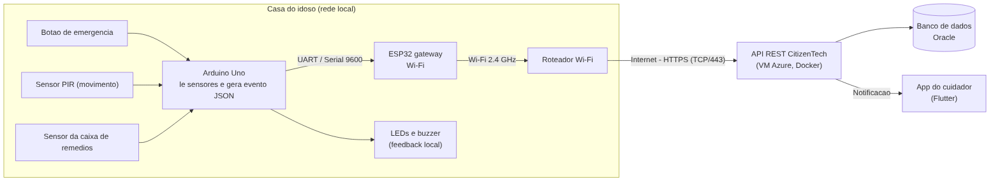

# CitizenTech - Idoso em casa com mais segurança (IoT)
**Global Solution 2026/2 · FIAP · Disruptive Architectures: IoT, IoB & Generative IA**

## Integrantes
| Ilda Ester Mussungayi Afonso | RM:568233   |

## 1. Problema e proposta CitizenTech
Muitos idosos moram sozinhos (estimativa de cerca de 5,7 milhões no Brasil) e as quedas são uma das principais causas de morte acidental entre pessoas 60+ (Ministério da Saúde, via Medicina S/A: 16.345 mortes em 2024). Eles também esquecem remédios e podem demorar a receber ajuda.

**Proposta:** um dispositivo na casa do idoso que detecta quatro situações e avisa o cuidador:
| Situação | Sensor | Evento enviado |
|----------|--------|----------------|
| Pedido de ajuda | Botão de emergência | `BOTAO_EMERGENCIA` |
| Remédio tomado no horário | Sensor da caixa de remédios | `MEDICAMENTO_TOMADO` |
| Remédio não tomado | Janela de tempo vence sem abrir a caixa | `MEDICAMENTO_NAO_TOMADO` |
| Sem movimento por muito tempo | Sensor PIR | `SEM_MOVIMENTO` |

- **Cidadão beneficiado:** idosos que vivem sozinhos e seus cuidadores. **ODS:** 3 e 10.
- Os tipos de evento são os mesmos da tabela `CIT_EVENTO` (banco de dados), da API e do app Flutter.

## 2. Protótipo
- **Placa:** Arduino Uno (simulado no [Wokwi](https://wokwi.com), arquivos em `wokwi/`).
- **Código:** `wokwi/sketch.ino`. **Circuito:** `wokwi/diagram.json`.
- **Como executar:** no Wokwi, crie um projeto Arduino Uno, cole o `sketch.ino` e o `diagram.json` e clique em *Start*. Abra o monitor serial.

### Componentes e pinos
| Componente | Pino | Função |
|------------|------|--------|
| Botão vermelho | D2 (INPUT_PULLUP) | Emergência |
| Sensor PIR | D3 | Movimento |
| Botão azul | D4 (INPUT_PULLUP) | Abertura da caixa de remédios (pressionado = aberta) |
| LED vermelho + 220 Ω | D8 | Emergência enviada |
| LED amarelo + 220 Ω | D7 | Hora do remédio |
| LED verde + 220 Ω | D6 | Sistema ligado (apaga rápido ao enviar evento) |
| Buzzer | D9 | Aviso sonoro |

### Funcionamento
1. O Arduino lê os sensores sem travar o programa (usa `millis()`, não `delay` na lógica de tempo) e faz *debounce* de 50 ms nos botões.
2. Cada evento sai pela Serial como uma linha JSON: `{"dispositivo":"ESP32-0001","tipo":"BOTAO_EMERGENCIA","t":12}`.
3. LEDs e buzzer dão aviso local imediato ao idoso.
4. **Tempos de demonstração:** 20 s sem movimento, remédio a cada 30 s com janela de 15 s. No uso real seriam 6 h, 8 h e 30 min (constantes no início do sketch).

## 3. Rede e fluxo de comunicação

| Etapa | Meio / protocolo | Componente |
|-------|------------------|------------|
| Sensores → Arduino | Sinal digital (GPIO) | Fios no protoboard |
| Arduino → gateway | UART/Serial 9600 bps, linha JSON | ESP32 (gateway) |
| Gateway → roteador | Wi-Fi 2.4 GHz (IEEE 802.11 b/g/n), DHCP | Roteador da casa |
| Roteador → API | Internet, HTTPS sobre TCP/443 | Provedor de internet |
| API → banco | Rede interna do Docker | Contêiner Oracle |
| API → cuidador | HTTPS (consulta pelo app) e notificação | App Flutter |

**Caminho do dado:** botão pressionado → Arduino gera o JSON → ESP32 envia `POST /api/eventos` → API grava o evento e classifica a gravidade → cuidador vê o alerta no app.

**Observação sobre o escopo:** neste protótipo, o Arduino e a saída Serial foram simulados. O ESP32 gateway e o envio HTTP fazem parte da arquitetura proposta (documentada acima), mas não foram implementados nesta entrega.

## 4. Testes e evidências
Casos de teste executados no Wokwi (prints em `evidencias/`):

| # | Ação | Resultado esperado | Evidência |
|---|------|--------------------|-----------|
| T1 | Apertar o botão vermelho | JSON `BOTAO_EMERGENCIA`, LED vermelho e 3 bips | `evidencias/t1_emergencia.png` |
| T2 | Esperar 20 s sem clicar no PIR | JSON `SEM_MOVIMENTO` (1 vez) | `evidencias/t2_sem_movimento.png` |
| T3 | Clicar no PIR | Zera o contador e libera novo alerta | `evidencias/t3_movimento.png` |
| T4 | Esperar o LED amarelo e apertar o botão azul em até 15 s | JSON `MEDICAMENTO_TOMADO` | `evidencias/t4_tomado.png` |
| T5 | Esperar o LED amarelo e não apertar o botão azul | JSON `MEDICAMENTO_NAO_TOMADO` após 15 s | `evidencias/t5_nao_tomado.png` |
| T6 | Apertar o botão azul sem o LED amarelo aceso | Nenhum evento (não conta como remédio) | `evidencias/t6_fora_horario.png` |

**Critério de aprovação:** cada caso gera exatamente o evento esperado, uma vez, em até 1 s após a condição.
**Resultados:** (preencher depois de executar: aprovado/reprovado em cada caso).

## 5. Justificativas técnicas
- **Botão:** acionamento voluntário, mais simples e confiável para o idoso pedir ajuda.
- **Sensor PIR:** barato, detecta presença sem câmera, o que preserva a privacidade (LGPD).
- **Sensor na caixa de remédios:** mede o comportamento real (abriu ou não abriu), melhor que apenas um lembrete.
- **`INPUT_PULLUP`:** dispensa resistores externos e evita leitura flutuante.
- **`millis()` em vez de `delay()`:** o dispositivo continua lendo os sensores enquanto conta o tempo.
- **JSON por Serial:** formato simples, igual ao que a API recebe.
- **Arduino + ESP32 (arquitetura):** o Arduino cuida dos sensores; o ESP32 cuida apenas da conectividade Wi-Fi.
- **HTTPS:** protege dados pessoais em trânsito.

## 6. Limitações
- Simulação: não houve teste com hardware físico, ruído elétrico ou falsos positivos reais do PIR.
- O PIR só detecta movimento em um cômodo; o idoso pode estar parado e bem (alarme falso) ou em outro cômodo.
- Sem a internet, o alerta fica só no aviso local; o dispositivo real precisaria guardar os eventos e reenviar depois.
- Alimentação por bateria e queda de energia não foram tratadas.
- O botão exige que o idoso esteja consciente e perto dele; uma queda sem acesso ao botão não é detectada, a não ser pelo `SEM_MOVIMENTO`.
- Autenticação do dispositivo na API fica como trabalho futuro.

